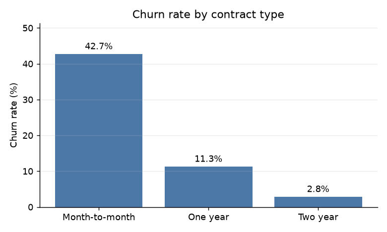
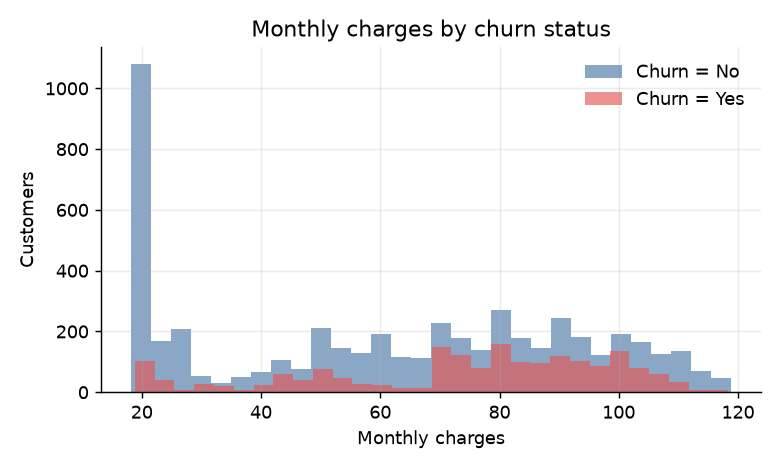
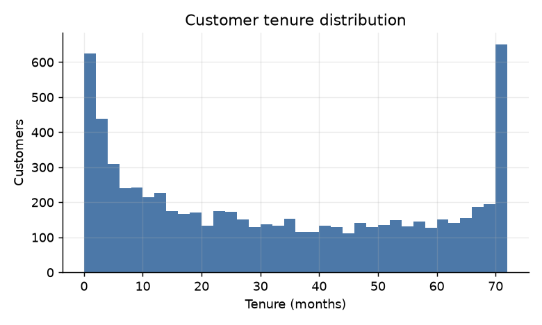

# Data Quality Report: Telco Customer Churn

_Auto-generated by `python -m src.report`; numbers come from the pipeline run, not hand-typed._

## 1. Summary

| Metric | Raw | Clean |
|---|---:|---:|
| Rows | 7,043 | 7,043 |
| Columns | 21 | 21 |
| Missing cells (true NaN) | 0 | 0 |
| Hidden blanks (empty strings) | 11 | 0 |
| Non-numeric (text) columns | 18 | 5 (typed categories/ids) |
| Memory (MB) | 7.15 | 0.66 |

## 2. The key finding: hidden missing values

`pd.isna()` reports **0** missing cells in the raw file, but `TotalCharges` contains **11 blank strings**. This also forces the whole column to text, which silently breaks any numeric analysis.

All 11 affected customers have `tenure = 0` (tenure values: [0]), i.e. they signed up this period and have not been billed yet. Their churn label is No in every case.

- **Decision:** the true value is 0, so impute `0.0` rather than the mean/median, which would invent about $2,283 of revenue per customer who has paid nothing.
- **Safeguard:** the pipeline raises an error if a blank ever appears for a customer with `tenure > 0`.

## 3. Cleaning log

| # | Step | What & why | Rows affected |
|---|---|---|---:|
| 1 | Rename columns | CamelCase -> snake_case (e.g. customerID -> customer_id) | 0 |
| 2 | Strip whitespace | Applied to 18 text columns | 11 |
| 3 | Fix type: total_charges | Blank strings -> NaN, column cast to float64 | 11 |
| 4 | Impute: total_charges | All blanks belong to tenure = 0 customers (no bill issued yet) -> set to 0.0 | 11 |
| 5 | Collapse redundant levels | 'No internet service' / 'No phone service' -> 'No' in 7 add-on columns (already encoded by internet_service / phone_service) | 9,838 |
| 6 | Encode Yes/No | 12 columns -> int8 (1 = Yes) | 0 |
| 7 | Set categorical dtypes | gender, internet_service, payment_method -> category; contract -> ordered category | 0 |

## 4. Validation checks

| Check | Result | Detail |
|---|:-:|---|
| customer_id is unique | PASS | 7043 unique ids |
| No missing values | PASS | 0 nulls |
| No duplicate rows | PASS | 0 duplicates |
| tenure >= 0 | PASS | range 0-72 months |
| monthly_charges > 0 | PASS | range 18.25-118.75 |
| total_charges >= 0 | PASS | min 0.00 |
| Binary columns contain only 0/1 | PASS | 13 columns |
| Contract levels as expected | PASS | Month-to-month, One year, Two year |
| tenure = 0 <=> total_charges = 0 | PASS | billing history consistent with tenure |

## 5. Outliers (IQR rule), reviewed and kept

| Column | Outliers | Fence (low, high) |
|---|---:|---|
| tenure | 0 | (-60.0, 124.0) |
| monthly_charges | 0 | (-46.0, 171.4) |
| total_charges | 0 | (-4683.5, 8868.7) |

0 IQR outliers were found, so no rows were removed or capped. `total_charges` is naturally right-skewed because long-tenure customers accumulate more charges; consider a log transform for linear models downstream.

## 6. Consistency observation (not altered)

`total_charges` should be close to `tenure x monthly_charges`. 13 rows (0.2%) deviate by more than 30%; a plausible cause is plan changes over a customer's lifetime, but this cannot be verified from the dataset. Values were left untouched and are flagged for downstream awareness.

## 7. Target balance

Churn = Yes for **26.5%** of customers (1,869 of 7,043). The classes are moderately imbalanced: use stratified splits and report precision/recall/PR-AUC, not accuracy alone.

## 8. Figures

