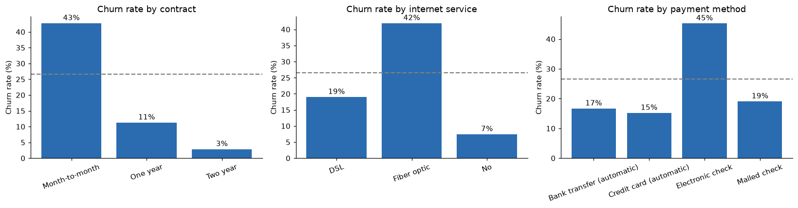
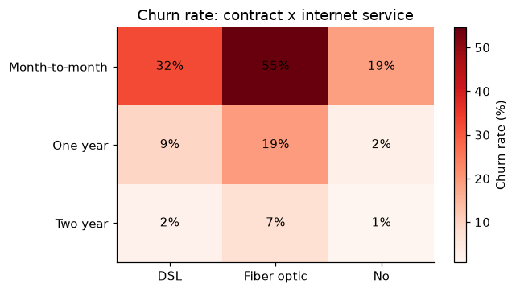
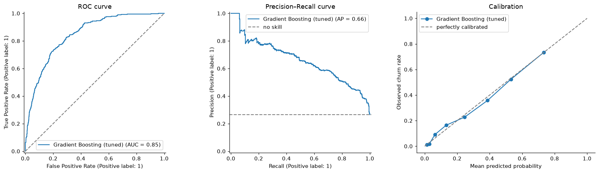
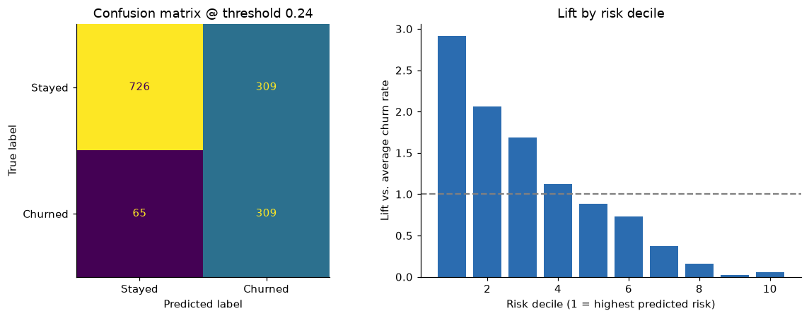
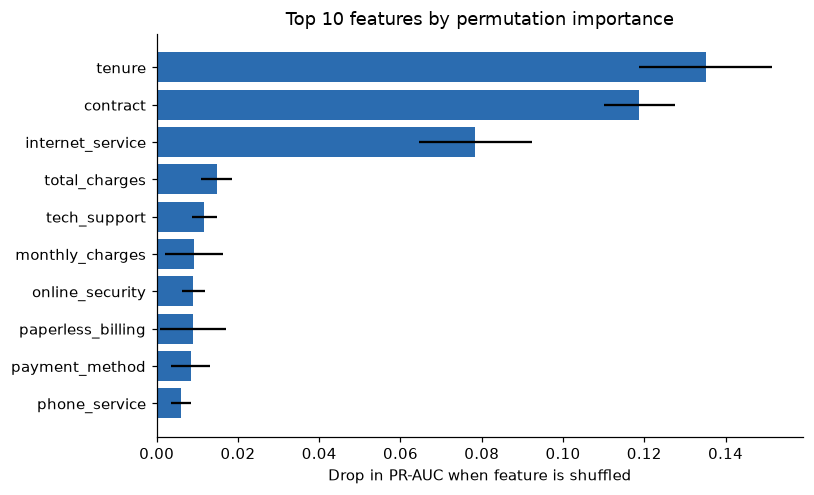

# Final Report: Customer Churn Analysis and Prediction

**SWYNEX Technologies Data Science Internship, Task 4** · Author: Karthik

## 1. Executive summary
A telecom operator wants to keep customers who are about to leave without wasting retention offers on those who will stay. Using the IBM Telco dataset (7,043 customers, 26.5% churn), this project cleaned the data, identified what separates churners from loyal customers, and built a model that ranks customers by churn risk.

- **Who churns:** new customers on month-to-month contracts, paying by electronic check, on fiber optic plans, without security or tech-support services.
- **Model:** tuned Gradient Boosting, **PR-AUC 0.662** (baseline 0.265) and **ROC-AUC 0.846** on a held-out test set.
- **Targeting:** the riskiest 10% of customers contain **29%** of churners (2.9x lift). At the cost-optimised threshold the model catches **83%** of churners with **50%** precision.
- **Value (illustrative):** about **$51.7k** net benefit on 1,409 test customers vs $27.5k for contacting everyone.

## 2. Data preparation (Task 1)
- `TotalCharges` looked complete to pandas but held **11 blank strings**, which forced the column to text. All 11 customers have tenure 0 (not yet billed), so the correct value is **0**, not the mean. The pipeline enforces this and raises an error if a blank ever appears for a customer with billing history.
- "No internet/phone service" levels (9,838 cells) were merged into "No" because the internet and phone columns already carry that information.
- Yes/No columns became 0/1; categories were typed; the contract was made an ordered category; column names became snake_case.
- **Validation:** 9/9 checks pass (unique IDs, no nulls, no duplicate rows, valid ranges, billing consistent with tenure). 9 unit tests pass. No IQR outliers were found.
- 13 rows (0.2%) have `total_charges` far from `tenure x monthly_charges`; they were left unchanged and flagged.

## 3. Exploratory analysis (Task 2)
| # | Finding | Evidence |
|---|---|---|
| 1 | Contract type is the strongest driver | Month-to-month 42.7% churn, one-year 11.3%, two-year 2.8% (Cramér's V = 0.41) |
| 2 | Churn is front-loaded | 47.4% churn in months 0-12 vs 9.5% after 48 months; 55% of churners leave within a year |
| 3 | Fiber optic customers churn most | 41.9% vs 19.0% DSL, although they pay the most ($91.5/month on average) |
| 4 | Electronic-check payers churn most | 45.3% vs 15-19% for other payment methods |
| 5 | Security and support go with lower churn | Among internet customers: online security 14.6% vs 41.8%; tech support 15.2% vs 41.6% |
| 6 | Streaming add-ons barely matter | 3-4 point difference |
| 7 | Gender and phone service carry no signal | p = 0.49 and p = 0.34 |
| 8 | A concentrated high-risk segment | Month-to-month + fiber + electronic check: 1,307 customers (18.6%), 60% churn, 42% of all churners |

Churners also pay more per month (median $79.65 vs $64.43) and have much shorter tenure (median 10 vs 38 months). All numeric differences are highly significant. `tenure` and `total_charges` are strongly correlated (r = 0.83).

## 4. Modeling and evaluation (Task 3)
**Setup.** Stratified 80/20 split; 5-fold stratified CV on the training set only; all preprocessing inside an sklearn `Pipeline` (no leakage); one engineered feature (number of add-on services); the test set used once.

| Model (5-fold CV) | PR-AUC | ROC-AUC |
|---|---|---|
| Dummy (majority class) | 0.265 | 0.500 |
| Logistic Regression | 0.661 ± 0.019 | 0.846 ± 0.012 |
| Random Forest | 0.656 ± 0.023 | 0.844 ± 0.010 |
| Hist. Gradient Boosting | 0.641 ± 0.023 | 0.834 ± 0.007 |
| Logistic Regression (tuned) | 0.662 ± 0.019 | 0.846 ± 0.013 |
| **Gradient Boosting (tuned)** | **0.667 ± 0.023** | **0.849 ± 0.012** |

Tuned Gradient Boosting is nominally best, but its margin over Logistic Regression is smaller than the fold-to-fold noise. Logistic Regression is a defensible, more transparent alternative.

**Held-out test results (n = 1,409):** PR-AUC 0.662 (95% CI 0.609-0.713), ROC-AUC 0.846 (0.823-0.868), Brier 0.136 (no-skill 0.195).

**Threshold from business cost.** A retention offer costs $50, saves 30% of churners, and a saved customer is worth 12 months of their monthly charges (all illustrative). The threshold was chosen on out-of-fold training predictions:

| | Precision | Recall | F1 | Contacted | Net benefit |
|---|---|---|---|---|---|
| Default threshold 0.5 | 0.656 | 0.524 | 0.582 | 299 | $39,341 |
| **Cost-optimised 0.24** | 0.500 | 0.826 | 0.623 | 618 | **$51,738** |

Contacting every customer would yield $27,524; contacting nobody, $0.

**Interpretation.** Permutation importance ranks **tenure, contract and internet service** highest, matching the EDA.

**Error analysis.** At threshold 0.24 recall is 0.92 on month-to-month customers and 0.91 for tenure up to 12 months, but only 0.19 on one-year contracts and 0.43 for customers with 49+ months. No two-year customers are flagged (only 2.7% of them churn). Performance is strongest where most churn occurs.

## 5. Recommendations
1. **Target the month-to-month, high-risk segment first.** Use the model's risk score (threshold 0.24) to choose who receives an offer.
2. **Build an early-life program.** More than half of churn happens in year one: onboarding calls, a 90-day check-in, and early-tenure offers.
3. **Push contract upgrades.** Moving customers from month-to-month to annual contracts is associated with the largest drop in churn.
4. **Move customers off electronic check** to automatic payment with a small incentive.
5. **Investigate fiber optic.** High price and high churn suggest value-for-money or service-quality issues worth a root-cause review.
6. **Promote security and tech support**, but test the effect with an A/B pilot before assuming it causes retention.

## 6. Limitations
1. Cost assumptions are placeholders; the best threshold and dollar benefit move with them.
2. Static snapshot with no time dimension: no temporal validation, no drift monitoring; the random split may be optimistic.
3. Importance and EDA findings are associations, not causal effects.
4. One public, single-operator dataset; no usage, complaint, network-quality or competitor data.
5. Fairness not assessed (`gender`, `senior_citizen` are present).
6. Modest tuning budget (20-30 random-search iterations); further tuning would add little relative to CV noise.
7. Low recall on long-tenure and one-year-contract customers.

## 7. Next steps
Replace the cost assumptions with real figures and re-pick the threshold; add behavioural features (usage trends, support contacts) and validate on a time-based split; compare LightGBM/XGBoost and add SHAP explanations; run a randomised retention pilot to measure true uplift; monitor calibration and drift after launch.
